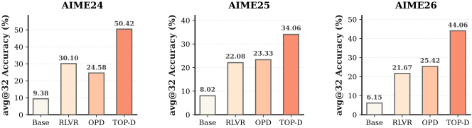

<h1 align="center">
  Trust Region Policy Distillation
</h1>

<p align="center">
  <a href="https://scholar.google.com/citations?user=QuK9uDcAAAAJ&amp;hl=en">Zhengpeng Xie</a><sup>*</sup>,
  <a href="https://scholar.google.com/citations?user=-_ItfAoAAAAJ&amp;hl=en">Li Lyna Zhang</a><sup>†</sup>,
  <a href="https://scholar.google.com/citations?user=ysXmZCMAAAAJ&amp;hl=en">Zeke Xie</a><sup>‡</sup>,
  <a href="https://scholar.google.com/citations?user=LgJqohwAAAAJ&amp;hl=en">Mao Yang</a>
</p>

<p align="center">
  <sub>* Work done during an internship. &nbsp; † Project leader. &nbsp; ‡ Corresponding author.</sub>
</p>

<p align="center"><b>Accepted to NeurIPS 2026</b></p>

<p align="center">
  <a href="https://arxiv.org/abs/2607.04751">Paper</a> &nbsp;·&nbsp;
  <a href="#minimal-implementation">Implementation</a> &nbsp;·&nbsp;
  <a href="#quick-start">Quick start</a> &nbsp;·&nbsp;
  <a href="#citing-top-d">Citation</a>
</p>

<!-- Figure 1: https://arxiv.org/html/2607.04751v1/teaser.svg -->
<p align="center">
  
</p>
<p align="center">
  <em>Figure 1: While standard OPD forces direct teacher supervision and suffers from unstable optimization, TOP-D ensures stable training by dynamically constructing a proximal teacher at every iteration.</em>
</p>

<!-- Figure 2: https://arxiv.org/html/2607.04751v1/aime_performance.svg -->
<p align="center">
  
</p>
<p align="center">
  <em>Figure 2: The avg@32 accuracy on several AIME benchmarks for RLVR applied to the Qwen3-8B-Base model, and for OPD and TOP-D using Qwen3-30B-A3B-Instruct-2507 as the teacher model.</em>
</p>

**Minimal TOP-D / OPD on [verl](https://github.com/verl-project/verl).** Runtime, recipes, and original math data included—no extra checkout or patch step.

## Minimal implementation

Student rollouts → teacher scores → token advantages → existing PPO update. Core excerpts below omit surrounding checks and branches.

1. **Reuse the reference teacher.** Separate weights; the student tokenizer supplies shared EOS/PAD metadata.

   ```bash
   +actor_rollout_ref.ref.model.path="${TEACHER_MODEL_PATH}"
   +actor_rollout_ref.ref.model.tokenizer_path="${REF_TOKENIZER_PATH}"
   ```

   `REF_TOKENIZER_PATH` defaults to `MODEL_PATH`. The [FSDP worker](verl/verl/workers/fsdp_workers.py) loads the selected tokenizer; the teacher only scores, never generates or trains.

2. **[`core_algos.py`](verl/verl/trainer/ppo/core_algos.py#L338-L472): token advantages.** Both rewards use the same sampled token; `p_student` is its pre-update student probability.

   ```python
   # OPD reward: log(p_teacher / p_student)
   advantages = (ref_log_prob - old_log_probs) * response_mask

   # TOP-D reward: log(alpha * (p_teacher / p_student) + (1 - alpha))
   # log_ratio = ref_log_prob - old_log_probs on valid tokens.
   topd_rewards = torch.logaddexp(
       log_ratio + math.log(alpha),
       torch.full_like(log_ratio, math.log1p(-alpha)),
   )
   token_returns = _compute_topd_token_returns(topd_rewards, response_mask)
   advantages = _normalize_topd_token_returns_by_prompt(
       token_returns, response_mask, index=index
   )
   ```

   Return = **current reward + mean future reward**, normalized within each prompt group. Naive TOP-D uses only the immediate transform. Full functions handle padding, boundaries, and `no_grad`.

3. **[`ray_trainer.py`](verl/verl/trainer/ppo/ray_trainer.py#L261-L296): connect the estimator.** Score the same tokens with the pre-update student and reference teacher, then reuse the actor update.

   ```python
   compute_topd_fn = core_algos.compute_topd_advantage
   advantages, returns = compute_topd_fn(
       token_level_rewards=data.batch["token_level_rewards"],
       response_mask=data.batch["response_mask"],
       old_log_probs=data.batch["old_log_probs"],
       ref_log_prob=data.batch["ref_log_prob"],
       index=data.non_tensor_batch["uid"] if "uid" in data.non_tensor_batch else None,
       config=config,
   )
   data.batch["advantages"] = advantages
   data.batch["returns"] = returns
   ```

## Quick start

**Linux · Python 3.12 · CUDA 12.9 · PyTorch 2.10.0 · vLLM 0.17.0.** Use a compatible NVIDIA driver and an isolated environment.

### 1. Install

```bash
git clone https://github.com/xie-lab-ml/TOP-D.git
cd TOP-D
python3.12 -m venv .venv
source .venv/bin/activate
bash install.sh
```

Dependencies already match? Use `bash install.sh --existing-env`. Keep the same environment active for all commands.

### 2. Download models

```bash
# Student
hf download Qwen/Qwen3-1.7B-Base --local-dir ./model/Qwen3-1.7B-Base
# Reference teacher
hf download Qwen/Qwen3-30B-A3B-Instruct-2507 --local-dir ./model/Qwen3-30B-A3B-Instruct-2507
```

Skip existing complete checkpoints; set `MODEL_PATH` / `TEACHER_MODEL_PATH` to use other locations. No weights are committed.

### 3. Run

```bash
# TOP-D
RESET_RAY=0 bash recipe/opd/run_qwen3_1p7b_base_qwen3_30a3b_teacher_dapo17k_topd_alpha0p1_16k_kl0.sh
# OPD
RESET_RAY=0 bash recipe/opd/run_qwen3_1p7b_base_qwen3_30a3b_teacher_dapo17k_opd_16k_kl0.sh
# Naive TOP-D
RESET_RAY=0 bash recipe/opd/run_qwen3_1p7b_base_qwen3_30a3b_teacher_dapo17k_naive_topd_alpha0p1_16k_kl0.sh
```

Use a dedicated node with sufficient GPU/host memory. `RESET_RAY=0` avoids stopping Ray; do not join an unrelated cluster.

| Setting | Default |
|---|---|
| Student / teacher | Qwen3-1.7B-Base / Qwen3-30B-A3B-Instruct-2507 |
| Rollout batch | 128 prompts × 8 responses |
| PPO minibatch | OPD: 128; TOP-D / naive TOP-D: 32 |
| PPO / log-prob microbatch per GPU | 1 / 1 |
| Prompt / response limit | 2,048 / 16,384 tokens |
| Learning rate / TOP-D `alpha` | `1e-6` / `0.1` |
| Validation | avg@16 on AIME24 / AIME25 / AIME26 |

All four batch settings live in the individual [entry scripts](recipe/opd/); common only validates and forwards them.

> [!IMPORTANT]
> **Single-node defaults:** for practical **1-node / 8-GPU** runs, batch **128** and **avg@16** are smaller than the paper's **512** and **avg@32**. For paper reproduction or performance exploration, use **4 nodes / 32 GPUs** and the paper's full hyperparameters.

## Data and checks

Original **DAPO-Math-17k (17,398)** and **AIME24 / 25 / 26 (30 each)** are in [`recipe/data/`](recipe/data/), with [checksums](recipe/data/data_manifest.json) and [source licenses](recipe/data/NOTICE.txt). avg@16 means mean correctness—not pass@16 or best-of-16.

```bash
python recipe/verification/verify_release.py --decode-data
python recipe/verification/check_core.py
```

<details>
<summary>Environment, compatibility, and validation limits</summary>

- Install the bundled `verl/` with the [observed dependency pins](recipe/environment/requirements.txt). Avoid the inherited `[vllm]` extra; its version cap is older. FlashAttention may need a matching CUDA compiler. `bash install.sh --check` inspects versions.
- The original [download helper](recipe/opd/download_models.sh) is optional. Its `STUDENT_DIR` / `TEACHER_DIR` control download destinations; training uses `MODEL_PATH` / `TEACHER_MODEL_PATH`.
- The reference reuses the student tokenizer by default. Startup checks EOS, PAD, and tokenizer length; the FSDP loader consumes `ref.model.tokenizer_path`. **Token-ID layouts must already be compatible**—this is not cross-vocabulary remapping. A different teacher architecture may also require `TEACHER_LAYER_CLS`.
- [Source provenance](recipe/verification/source_manifest.json) records original hashes, latest script readbacks, release defaults, and the FSDP tokenizer-path compatibility fix. Optional local comparison: `python recipe/verification/verify_release.py --original /path/to/original/project --decode-data`.
- Checks cover file/data integrity, CPU algorithm numerics, and tokenizer-path wiring. **A fresh CUDA install and end-to-end GPU reproduction remain unverified.** Eight GPUs of arbitrary memory capacity are not sufficient by definition.
- `model/`: checkpoints; `recipe/`: launchers, data, checks; `verl/`: bundled runtime. [Upstream module docs](verl/README.md) are reference material, not TOP-D setup instructions.

</details>

## Citing TOP-D

```bibtex
@article{xie2026trust,
title={Trust Region Policy Distillation},
author={Xie, Zhengpeng and Zhang, Li Lyna and Xie, Zeke and Yang, Mao},
journal={arXiv preprint arXiv:2607.04751},
year={2026}
}
```

## License and acknowledgments

Built on [verl](https://github.com/verl-project/verl). Code: [Apache-2.0](LICENSE), with [upstream notices](verl/Notice.txt) retained. Data and models have separate terms: **AIME26 is CC BY-NC-SA 4.0** (attribution, non-commercial, share-alike). See the [data notice](recipe/data/NOTICE.txt); the code license does not override dataset or examination-material rights.
