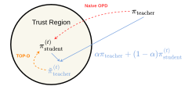

<h1 align="center">
  Trust Region Policy Distillation
</h1>

<p align="center">
  <a href="https://scholar.google.com/citations?user=QuK9uDcAAAAJ&amp;hl=en">Zhengpeng Xie</a><sup>*</sup>,
  <a href="https://scholar.google.com/citations?user=-_ItfAoAAAAJ&amp;hl=en">Li Lyna Zhang</a><sup>†</sup>,
  <a href="https://scholar.google.com/citations?user=ysXmZCMAAAAJ&amp;hl=en">Zeke Xie</a><sup>‡</sup>,
  <a href="https://scholar.google.com/citations?user=LgJqohwAAAAJ&amp;hl=en">Mao Yang</a>
</p>

<p align="center">
  <sub>* Work done during an internship. &nbsp; † Project leader. &nbsp; ‡ Corresponding author.</sub>
</p>

<p align="center">
  <b>Accepted to NeurIPS 2026</b>
</p>

<p align="center">
  <a href="https://arxiv.org/abs/2607.04751">Paper</a> &nbsp;·&nbsp;
  <a href="#minimal-implementation">Implementation</a> &nbsp;·&nbsp;
  <a href="#quick-start">Quick start</a> &nbsp;·&nbsp;
  <a href="#citing-top-d">Citation</a>
</p>

<!-- Figure 1, original vector asset: https://arxiv.org/html/2607.04751v1/teaser.svg -->
<p align="center">
  
</p>

<p align="center">
  <em>Figure 1: While standard OPD forces direct teacher supervision and suffers from unstable optimization, TOP-D ensures stable training by dynamically constructing a proximal teacher at every iteration.</em>
</p>

A **minimal implementation of TOP-D and On-Policy Distillation (OPD)** built on [verl](https://github.com/verl-project/verl). The repository includes the working runtime, training recipes, and original math datasets—no separate upstream checkout or patch step.

## Minimal implementation

**The student generates; the reference model teaches.** We load the teacher checkpoint through `actor_rollout_ref.ref.model.path` and reuse verl's existing reference-policy worker to score the student's response tokens. The teacher is frozen: it does not generate training responses or receive optimizer updates. The proximal teacher is computed algebraically, not instantiated as another model.

```text
Student-generated responses
  -> pre-update student log probs + reference-teacher log probs
  -> OPD / TOP-D token advantages
  -> existing clipped PPO actor update
```

The two main places to read are:

- **[`core_algos.py`](verl/verl/trainer/ppo/core_algos.py)** defines the advantage estimators. OPD uses `log_ratio = ref_log_prob - old_log_probs`. TOP-D transforms it into `log((1 - alpha) + alpha * exp(log_ratio))`, adds the mean reward of later response tokens, and normalizes valid-token returns within each prompt group. The code uses `logaddexp` for numerical stability. **Naive TOP-D** is the ablation that applies only the immediate-reward transform.
- **[`ray_trainer.py`](verl/verl/trainer/ppo/ray_trainer.py)** connects the pieces: student rollout, student/reference scoring on the **same sampled tokens**, advantage computation, and actor update. The default recipe recomputes the pre-update student's `old_log_probs` before optimization.

Small supporting changes enable the reference worker for distillation in [`utils.py`](verl/verl/trainer/ppo/utils.py) and load its separate teacher checkpoint in [`fsdp_workers.py`](verl/verl/workers/fsdp_workers.py). “Reference” is the worker's role, **not a copy of the student**; teacher scoring remains necessary even when the extra KL coefficients are zero.

## Quick start

### 1. Install

Use **Linux, Python 3.12, CUDA 12.9, PyTorch 2.10.0, and vLLM 0.17.0** with a compatible NVIDIA driver.

```bash
git clone https://github.com/xie-lab-ml/TOP-D.git
cd TOP-D
python3.12 -m venv .venv
source .venv/bin/activate
bash install.sh
```

The installer uses the bundled `verl/` and the [versions observed in the working environment](recipe/environment/requirements.txt). Use an isolated environment; FlashAttention may need a matching CUDA toolkit/compiler. If those dependencies are already installed, run `bash install.sh --existing-env`. Use `bash install.sh --check` to inspect versions.

<details>
<summary>Installation details</summary>

The installer intentionally avoids `pip install .[vllm]`: the inherited optional dependency has an older vLLM cap. Additional pinned packages include Transformers 5.2.0, Ray 2.54.0, FlashAttention 2.8.3, NumPy 1.26.4, Pandas 3.0.1, and PyArrow 23.0.1. The original container build recipe is retained at [`verl/docker/Dockerfile.stable.vllm`](verl/docker/Dockerfile.stable.vllm).

</details>

### 2. Put the models in `model/`

Run from the repository root. Skip downloading if you already have the complete checkpoints.

```bash
# Student: download the complete checkpoint into model/.
hf download Qwen/Qwen3-1.7B-Base \
  --local-dir ./model/Qwen3-1.7B-Base

# Teacher: loaded through the existing reference-model path.
hf download Qwen/Qwen3-30B-A3B-Instruct-2507 \
  --local-dir ./model/Qwen3-30B-A3B-Instruct-2507
```

These are the paths used by the recipes by default. Keep all weight shards, configuration, and tokenizer files; no weights are committed to this repository. The original helper, `bash recipe/opd/download_models.sh`, downloads to the same default locations.

<details>
<summary>Use checkpoints stored elsewhere</summary>

Point the training recipe to your existing checkpoint directories:

```bash
export MODEL_PATH=/path/to/Qwen3-1.7B-Base
export TEACHER_MODEL_PATH=/path/to/Qwen3-30B-A3B-Instruct-2507
```

The download helper uses `STUDENT_DIR` / `TEACHER_DIR` for its output paths; training uses `MODEL_PATH` / `TEACHER_MODEL_PATH`. If you customize the download locations, set the training variables accordingly. The default teacher is MoE and uses `Qwen3MoeDecoderLayer`; `TEACHER_LAYER_CLS` can be overridden for another architecture.

</details>

### 3. Run a recipe

The default setup is **one eight-GPU node, 128 prompts per rollout batch, eight responses per prompt, and avg@16 evaluation**. Use an idle, dedicated node with sufficient GPU and host memory for the 30B-A3B teacher and 16K responses.

```bash
# TOP-D
RESET_RAY=0 bash recipe/opd/run_qwen3_1p7b_base_qwen3_30a3b_teacher_dapo17k_topd_alpha0p1_16k_kl0.sh

# OPD baseline
RESET_RAY=0 bash recipe/opd/run_qwen3_1p7b_base_qwen3_30a3b_teacher_dapo17k_opd_16k_kl0.sh

# Naive TOP-D ablation
RESET_RAY=0 bash recipe/opd/run_qwen3_1p7b_base_qwen3_30a3b_teacher_dapo17k_naive_topd_alpha0p1_16k_kl0.sh
```

`RESET_RAY=0` prevents the original script from stopping existing Ray processes. Do not attach to an unrelated cluster.

| Setting | Default |
|---|---|
| Student / teacher | Qwen3-1.7B-Base / Qwen3-30B-A3B-Instruct-2507 |
| Rollout batch | 128 prompts × 8 responses |
| PPO minibatch | OPD: 128 prompts; TOP-D / naive TOP-D: 16 prompts |
| TOP-D `alpha` | 0.1 |
| Prompt / response limit | 2,048 / 16,384 tokens |
| Learning rate | `1e-6` |
| Evaluation | avg@16 on AIME24, AIME25, and AIME26 |

**avg@16** averages correctness over 16 completions per question, then over questions; it is not pass@16 or best-of-16. This release defaults to avg@16, while the paper reports avg@32. The original metric computation is retained.

## Data and layout

The original Parquet files are included under [`recipe/data/math_reasoning_parquet/`](recipe/data/math_reasoning_parquet/): **DAPO-Math-17k (17,398 training examples)** and **AIME24 / AIME25 / AIME26 (30 evaluation problems each)**. Their bytes, row order, prompts, answers, and metadata match the original experiment files. See the [checksums](recipe/data/data_manifest.json) and [dataset sources and licenses](recipe/data/NOTICE.txt).

```text
TOP-D/
├── model/                 # checkpoint destinations; initially only .gitkeep
├── recipe/
│   ├── opd/               # launch scripts and reward function
│   ├── data/              # original math datasets
│   ├── environment/       # dependency pins and environment checks
│   ├── verification/      # file-identity and CPU checks
│   └── assets/            # paper teaser
├── verl/                  # complete bundled runtime and install metadata
├── install.sh
└── README.md
```

<details>
<summary>Source fidelity and validation scope</summary>

The original 482-file runtime, installation metadata, and six recipe files were checked against the working project. The declared release changes select the 30B-A3B teacher and its MoE wrapping, mirror avg@16 in the `val-core` display alias, and clarify documentation/comments. Training algorithms, optimization, sampling, and determinism settings are preserved. Source hashes and declared differences are recorded in [`source_manifest.json`](recipe/verification/source_manifest.json).

```bash
# Verify source files and the original Parquet bytes / decoded row content.
python recipe/verification/verify_release.py --decode-data

# CPU-only checks of OPD / TOP-D and the avg@16 display alias.
python recipe/verification/check_core.py

# Optional: compare against an original project on the same filesystem.
python recipe/verification/verify_release.py --original /path/to/original/project --decode-data
```

File-identity and CPU checks have passed. A fresh Linux installation, GPU model loading, distributed training, memory requirements on other cards, and paper-level scores have **not been independently revalidated for this packaged release**. Matching files or package versions is not a substitute for an end-to-end GPU run. Eight GPUs of arbitrary memory capacity are not automatically sufficient.

</details>

## Citing TOP-D

If you find this work useful, please cite:

```bibtex
@article{xie2026trust,
title={Trust Region Policy Distillation},
author={Xie, Zhengpeng and Zhang, Li Lyna and Xie, Zeke and Yang, Mao},
journal={arXiv preprint arXiv:2607.04751},
year={2026}
}
```

## Acknowledgments and license

Built on [verl](https://github.com/verl-project/verl). We thank its contributors for the training infrastructure.

Code is licensed under [Apache-2.0](LICENSE), with upstream notices preserved in [`verl/Notice.txt`](verl/Notice.txt). **Datasets and model checkpoints retain their own terms. In particular, AIME26 is CC BY-NC-SA 4.0** (attribution, non-commercial, share-alike); see [`recipe/data/NOTICE.txt`](recipe/data/NOTICE.txt). The other dataset source cards identify Apache-2.0, without overriding rights in the original examination materials.
